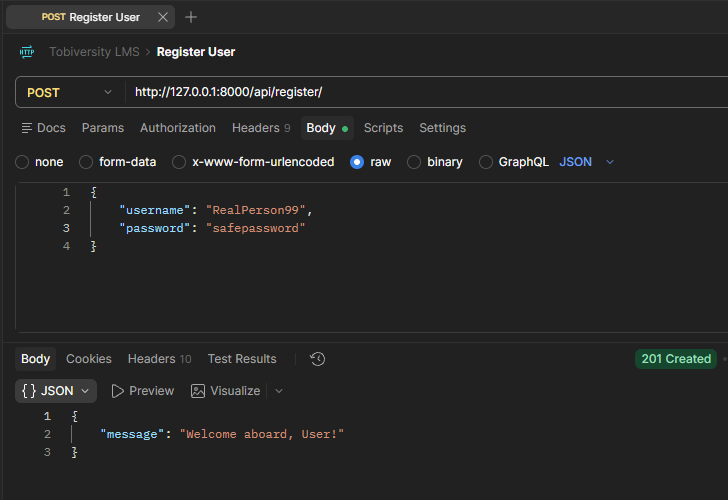
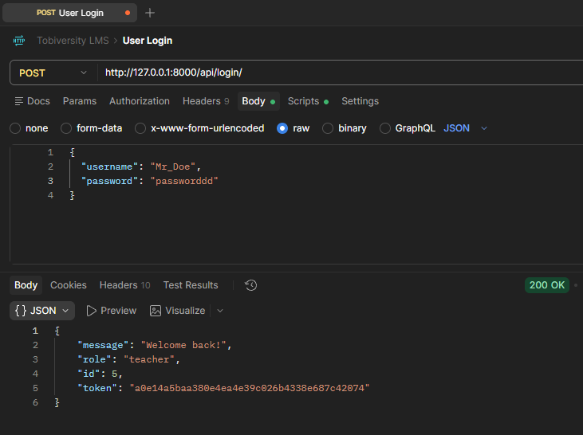
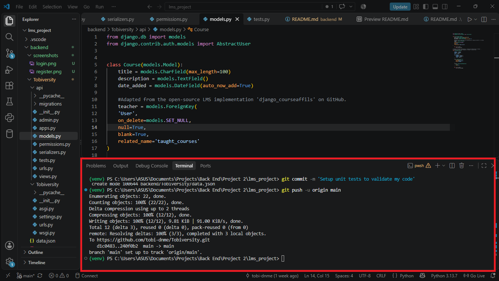
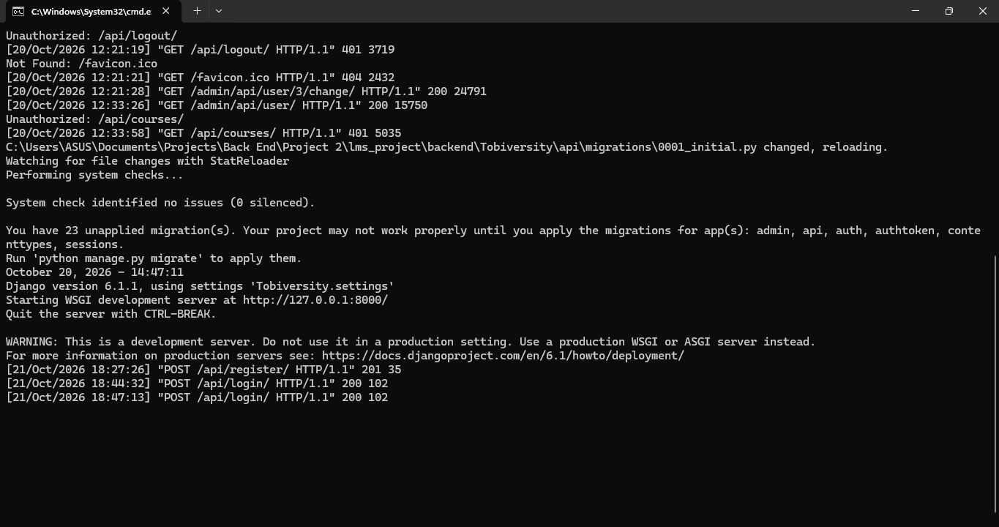
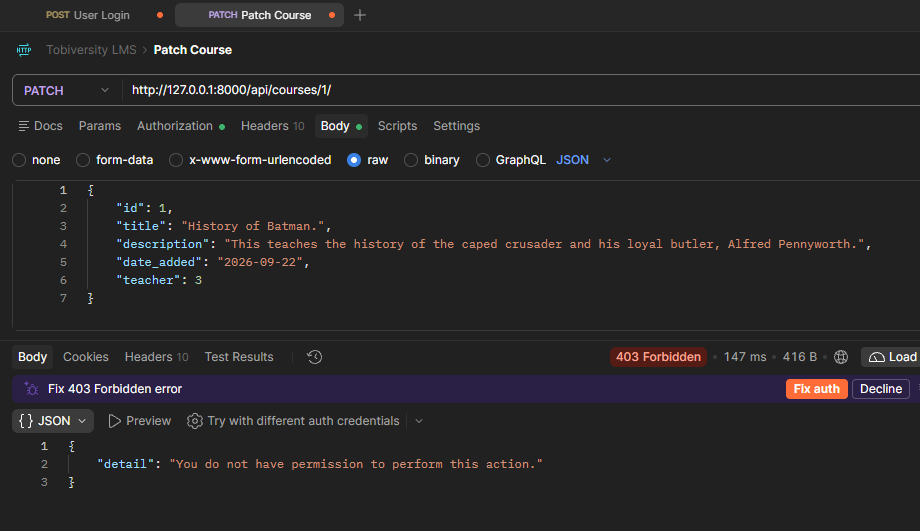
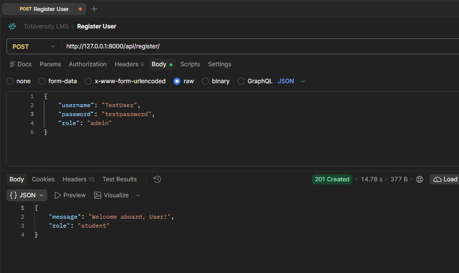
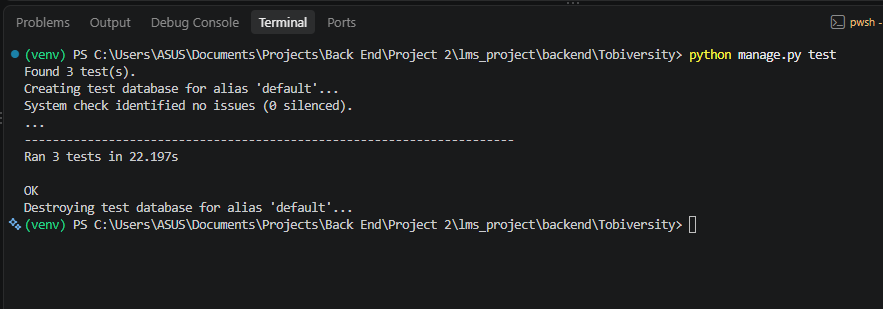

# Tobiversity — Backend

The Django REST Framework API that powers **Tobiversity**. It stores the users and courses, decides who is allowed to do what, and passed legible JSON over to the React frontend. (Still not over the name... because my name is Tobi.)

**Created by Tobi Olu**

---

## Concept

The backend has one job: **know who you are, and only let you do what your role allows.**

Every request that comes in gets asked three questions:

1. *Who are you?* → Token authentication (you log in, you get a token, you send it back with every request).
2. *What's your role?* → Student, Teacher or Admin, backed by Django **groups** and **permissions**.
3. *Is this actually yours?* → Object-level checks, so a teacher can only edit **their own** courses.


## How It Works

1. A new user makes the request `POST /api/register/`. They always start out as a **Student**, no matter what they send.



2. They log in at `POST /api/login/` and get back a token, their `id` and their `role`.

3. Every request after that carries the token in a header:

   ```
   Authorization: Token {{insert-token-here}}
   ```

4. The view checks the permission classes in `api/permissions.py` before it does anything:

   * **Students** can view courses, and see the courses they're enrolled in.
   * **Teachers** can view, create, edit and delete **their own** courses.
   * **Admins** can manage every course and every user.

5. Logging out (`POST /api/logout/`) deletes the token, so it can't be used again.

---

## Built With

* **Python & Django** – Models, migrations, admin and the project skeleton
* **Django REST Framework** – Serializers, class-based API views, token authentication
* **SQLite** – Local database (`db.sqlite3`)
* **Postman** – Manual testing of every endpoint
* **Django's test framework** – Automated tests in `api/tests.py`

---

## Getting Started

You'll need a recent Python 3, activate the virtual environment, and install requirements. Then...

```bash
# from the backend/ folder

cd Tobiversity
python manage.py runserver
```

The API is now live at `http://127.0.0.1:8000/api/`.

Because I committed `db.sqlite3`, a fresh clone already has the groups and sample users inside it. Feel free to start a fresh database for your iteration.

> **Please note:** `RegisterView` looks for a group called `"Student"`, so this group must exist in your new database.

### Sample data

`data.json` comes with three groups (**Student**, **Teacher**, **Admin**) and some ready-made accounts to play with:

| Username | Role | 
|---|---|
| `Tobi` | Admin |
| `Sensei_Nathan` | Teacher |
| `Mr_Doe` | Teacher |
| `Decoy` | Student |
| `BurnerAccount` | Student |
| `RealPerson99` | Student |

And three courses: *History of Batman.*, *Star Trek vs Star Wars* and *The twisted mind of Quentin Tarantino*.



---

## My Setup: Two Terminals

I ended up working with **two terminals open at all times**, and it saved me a lot of confusion:

| Terminal | Where | What it does |
|---|---|---|
| **Terminal 1** | Inside VS Code | Local commands: `python manage.py test`, `makemigrations`, `migrate`, `git` |
| **Terminal 2** | External (outside VS Code) | Does one thing only: `python manage.py runserver` |

The server just sits in the external terminal and stays alive, so I can run tests, migrate and commit without ever having to stop it (or accidentally typing a command into the window that's running the server).




---

## The Data Models

Two models, and I deliberately connected them in **two different ways** so I'd understand both.

### `User` - `courses` is a Many-to-Many

```python
class User(AbstractUser):
    ...
    courses = models.ManyToManyField(
        Course,
        blank=True
    )
    ...
```

A student can be enrolled in many courses, and a course can have many students. Django handles this by quietly creating a **joiner table** in the database.

`User` extends `AbstractUser`, so I kept everything Django gives you for free (username, hashed password, groups, permissions) and added a `role` field with `student` / `teacher` / `admin` choices. `AUTH_USER_MODEL = 'api.User'` in `settings.py` tells Django to use it.

### `Course` - `teacher` is a Foreign Key

```python
class Course(models.Model):
    ...
    teacher = models.ForeignKey(
        'User',
        on_delete=models.SET_NULL,
        null=True,
        blank=True,
        related_name='taught_courses'
    )
    ...
```

A course has **one** teacher, but a teacher can have many courses. That's a one-to-many relationship, so it's a Foreign Key, which gives `Course` a real `teacher_id` column in the database.

`on_delete=models.SET_NULL` means that if a teacher account is deleted, their courses **don't disappear**. They just become teacher-less and admins can reassign them whenever.

### Two ways of reaching the data

Because the relationships are different, the views reach for the data differently too. Both live at the bottom of `views.py`:

```python
class StudentCourseView(APIView): # Using a ManyToMany relationship
    def get(self, request, id):
        joiner = User.courses.through.objects.filter(user_id=id)
        course_ids = joiner.values_list('course_id', flat=True)
        courses = Course.objects.filter(id__in=course_ids)
```

```python
class TeacherCourseView(APIView): # Using a ForeignKey relationship
    def get(self, request, id):
        courses = Course.objects.filter(teacher_id=id)
```

* **Many-to-Many** goes through the join table (`User.courses.through`), pulls out the `course_id` values, then fetches those courses.
* **Foreign Key** is one line, because the `teacher_id` column sits right on the `Course` table.

---

## Roles & Permissions

This was easily the part that took the longest, and where I learned the most.

### How roles are built

Roles are Django **groups**, each with a set of model permissions:

| Group | Course permissions | User permissions |
|---|---|---|
| **Student** | `view_course` | — |
| **Teacher** | `view`, `add`, `change`, `delete` | — |
| **Admin** | `view`, `add`, `change`, `delete` | `view`, `add`, `change`, `delete` |

The custom permission classes in `api/permissions.py` turn those into actual rules:

| Class | Used by | What it does |
|---|---|---|
| `CoursePermission` | `CourseView` | Maps each HTTP method to a Django permission (`GET` → `api.view_course`, `POST` → `api.add_course`, and so on). Then, for `PATCH`/`DELETE`, checks the teacher actually owns that course. |
| `UserPermission` | `UserView` | Admins can do everything. A normal user can view and edit **only their own** profile, and can't touch protected fields (`role`, `is_staff`, `is_superuser`, `is_active`, `groups`, `user_permissions`). |
| `IsSelfOrAdmin` | `StudentCourseView` | You can see your own enrolled courses; admins can see anyone's. |


### Rewriting the classes (more than once)

My first permission classes were simple, and they worked for the easy cases. As soon as the real requirements showed up (teachers owning their own courses, users editing only themselves, admins overriding everything), I realised patching them wasn't going to cut it. I **rewrote the classes entirely** rather than adding more `if` statements.

The end result is a clear sharing of responsibility:

* `has_permission` answers *"are you allowed to do this kind of thing at all?"*
* `has_object_permission` answers *"are you allowed to do it to **this** specific thing?"*

```python
def has_object_permission(self, request, view, obj):

    if request.method in SAFE_METHODS:
        return True

    if request.user.has_perm("api.change_user"):
        return True

    if "teacher" in request.data:
        return False

    return obj.teacher_id == request.user.pk
```

Reading that top to bottom: anyone can read; admins (the only group with `change_user`) can do anything; a teacher can't reassign a course to someone else by sneaking a `teacher` field into the request; and otherwise you have to be the course's teacher.


### Why you can't pick your role at signup

Early on it's tempting to let the signup form send `"role": "admin"`... bad idea. I did that initially, before realising it's only useful to test code.

```python
class RegisterView(APIView):
    def post(self, request):
        serializer = UserSerializer(data=request.data, partial=True)

        if serializer.is_valid():
            user = serializer.save(role=User.STUDENT)
            student_group = Group.objects.get(name="Student")
            user.groups.add(student_group)
```

Whatever the client sends, `serializer.save(role=User.STUDENT)` overrides it, and the new user is added to the **Student** group. Also, `UserSerializer.create()` only passes `username`, `email`, `password` and `role` on to `create_user()`, so things like `is_superuser` in the request body are simply ignored.

I **kept `role` in the serializers** on purpose, though. The frontend needs to *read* it (login returns it, and `GET /api/users/<id>/` includes it) so the right dashboard can be shown. And admins creating users through `POST /api/users/` can still set it. So the field is still there, you just can't self-assign it.

---

## API Endpoints

Everything lives under `/api/`.

| Method | Endpoint | Who | What it does |
|---|---|---|---|
| `POST` | `/api/register/` | Anyone | Create a **Student** account |
| `POST` | `/api/login/` | Anyone | Returns `token`, `id`, `role` |
| `POST` | `/api/logout/` | Logged in | Deletes your token |
| `GET` | `/api/courses/` | Student, Teacher, Admin | List all courses |
| `GET` | `/api/courses/<pk>/` | Student, Teacher, Admin | One course |
| `POST` | `/api/courses/` | Teacher, Admin | Create a course (teachers become its owner automatically) |
| `PATCH` | `/api/courses/<pk>/` | Owner teacher, Admin | Edit a course |
| `DELETE` | `/api/courses/<pk>/` | Owner teacher, Admin | Delete a course |
| `GET` | `/api/users/` | Admin | List users |
| `GET` / `PATCH` | `/api/users/<pk>/` | Admin, or yourself | View / edit a profile (non-admins can't change protected fields) |
| `POST` / `DELETE` | `/api/users/` · `/api/users/<pk>/` | Admin | Create / delete users |
| `GET` | `/api/users/<id>/courses/` | Yourself, or Admin | The courses a user is enrolled in (Many-to-Many) |
| `GET` | `/api/teachers/<id>/courses/` | Logged in | The courses a teacher teaches (Foreign Key) |

---

## Testing

I tested in **two different ways**, because they catch different things.

### 1. Postman

Postman was my first stop for every endpoint. The flow:

1. `POST /api/login/` as a user → copied the `token`.
2. Added the header `Authorization: Token {{token}}` to the next request.
3. Tried things I *should* be allowed to do, and then tried things I *shouldn't*.

The "shouldn't" ones matter most. Here's my checklist, with what I expect to see:

| Try this | Expected |
|---|---|
| Any course request with no token | `401` |
| Student → `POST /api/courses/` | `403` |
| Teacher → `PATCH` **their own** course | `200` |
| Teacher → `PATCH` **another teacher's** course | `403` |
| Teacher → `PATCH` their course with a `teacher` field in the body | `403` |
| Student → `PATCH /api/users/<own id>/` with a `role` field | `403` |
| Register with `"role": "admin"` in the body | `201`, but the account is a **Student** |
| `GET /api/courses/9999/` | `404` |
.


*While logged in as 'Mr_doe' (teacher_id: 5)...* 




*Trying to register a new user as an admin...* 




Feel free to have a look as my postman Test collection [here](https://tobimanuelolu-7457904.postman.co/workspace/bc265685-f948-4f48-8696-3c269ea2827f/collection/58708055-8357ad74-8dc6-453f-9ee0-159aea833424?action=share&source=copy-link&creator=58708055).

### 2. Django unit tests

Postman is great, but I have to remember to run it. The tests in `api/tests.py` run in one command and don't touch my real database, thanks to:

```bash
python manage.py test
```


What's in there:

| Test | What it proves |
|---|---|
| `test_courses_url_uses_course_view` | The `courses` route points at `CourseView` |
| `test_teacher_can_patch_own_course` | A teacher editing their own course gets a `200` and the title really changes |
| `test_teacher_cannot_patch_another_teachers_course` | A different teacher gets a `403` and the title is **unchanged** |


`setUp` builds a tiny world for each test: the Teacher and Student groups with their permissions, two teachers, one student, one course owned by `teacher_a`, and a token for each person. (The "cannot patch" test was generated by my editor's AI assistant, and I wrote the "can patch own" one myself.)



### The bug my own tests would have caught

My **first version** of the permissions only checked *group-level* rules, so the check was basically "does this user have `change_course`?" Every teacher has that permission, which meant **any teacher could edit any other teacher's course.** The whole thing *looked* like it worked: teachers could edit courses, students couldn't. It was only when I tried teacher B against teacher A's course that it fell apart.

The fix was the object-level layer: `has_object_permission` in `CoursePermission`. Now `test_teacher_cannot_patch_another_teachers_course` makes sure that doesn't happen.

>

## Committing the Database

Before moving on to the frontend, I **committed the database** (`db.sqlite3`) along with the `data.json` fixture. That means:

* the frontend can start against real groups, users, courses and enrolments, with no setup;
* there's a snapshot of the backend to go back to if something breaks later;
* anyone cloning the repo can log in as each role straight away.


---

## What I Learned

* **Models:** The same table can be reached in different ways, depending on whether the relationship is Many-to-Many (through the join table) or a Foreign Key (a column right on the model).
* **Permissions are a design problem, not a checkbox.** Group permissions say *what kind* of thing you can do; object permissions say *which* things.
* **Rewriting beats patching** when the requirements change shape.
* **Test the "no" cases.** The happy path almost always works. The bugs hide everywhere else.
* **Postman and unit tests are different tools.** One is for exploring; the other is for never having to explore the same thing twice.
* **Two terminals** is a tiny habit that made everything smoother.

---


Godspeed User.
